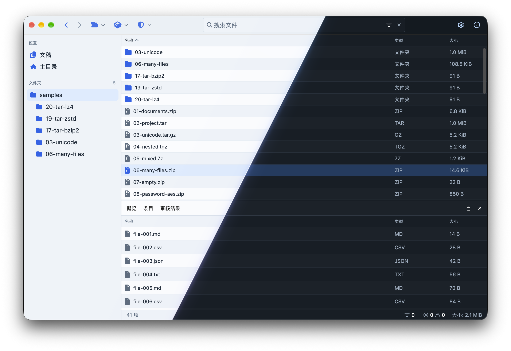

<h1>
  
</h1>

  A modern, security-focused, and fast cross-platform archive manager for
  compression, encryption, and inspection.

<strong>macOS · Windows · Linux</strong>

zarchive brings file browsing, archive creation, and detailed content inspection
into a single desktop workspace. Explore archives before extracting them, verify
the integrity of their contents, and prepare encrypted packages for storage or
sharing. Long-running operations work in the background, keeping the interface
available while your files are processed.

## Features

- **Browse before extracting.** Navigate folders and archives, use Back and
  Forward history, browse the folder tree, sort by name, type, or size, and open
  individual files in their default desktop applications.
- **Preview and edit text without extracting.** Single-click a text file on disk,
  an archive entry, or a standalone compressed text file to preview it in the
  bottom panel. UTF-8 and BOM-marked UTF-16 are supported, with syntax
  highlighting, line numbers, searching, scrolling, and copying. Choose Edit to
  modify local files or supported archive entries, then Save or Cancel. CSV table
  previews can switch to the text editor for editing when the target is writable.
  Archive changes use private staging and do not create an extracted copy in the
  browsed folder. Previews are limited to 128 KiB, and truncated previews cannot
  be saved to avoid discarding unseen data. Standalone compressed streams and
  RAR entries can be previewed but not edited.
- **Inspect and edit binary files.** The hex view shows offsets, byte values, and
  printable ASCII. Edit bytes as two-digit hex values and save local files or
  supported archive entries without visibly extracting them. Binary previews use
  the same 128 KiB safety limit; standalone compressed streams and RAR entries
  are not editable.
- **Preview CSV as a table.** CSV files, including archive entries and compressed
  CSV files, use a virtualized table with a fixed header and horizontal scrolling.
  Commas, semicolons, tabs, quoted fields, and multiline values are supported.
  Table previews are limited to 5,000 rows and 64 columns.
- **Search inside archives.** The toolbar search also checks files inside archives
  in the current disk folder, without opening each archive first. Scanning runs
  in the background, and results identify both the archive and the entry path.
  Inside an open archive, search covers the current folder and its subfolders.
  Files are not extracted during search; protected contents still require a
  password to open. Archive scans respect inspection limits and return up to
  5,000 matching entries. Archives with encrypted filenames must be unlocked
  before their entries can be searched.
- **Unified search and filters.** Combine file names with `ext:zip`, `min:1MiB`,
  `max:10MB`, `after:2026-01-01`, `before:2026-12-31`, and `type:file` or
  `type:folder` in the same search field. The dropdown offers operators, matching
  values, and a filter editor. Dates are inclusive; items without a known date
  are excluded from date-filtered results. Clear filters without removing the
  file-name query, or clear the search to reset everything.
- **Create and extract.** Package multiple files and folders, choose compression
  methods and levels, include hidden files, force ZIP64, or tune 7z dictionary and
  solid-compression settings. Encrypt ZIP and 7z archives, optionally encrypt 7z
  filenames, and extract entire archives or selected entries.
- **Manage background tasks.** A shared queue runs up to three tasks concurrently.
  Open the task indicator beside the status-bar error counters to view progress,
  pause, resume, cancel, or clear finished tasks. Extraction, archive creation and
  changes, moves, Trash, folder sizes, inspections, searches, and file previews use
  the queue. Tasks sharing a file or folder wait for each other. Pause and cancel
  are cooperative: an active codec or native system step may finish before the
  next checkpoint. Paused running tasks retain their worker reservation;
  cancellation does not undo files already moved or actions already committed.
- **Protect sensitive files.** Open password-protected ZIP and 7z archives and
  create AES-256 encrypted archives, including optional filename encryption for
  7z. Protected archives are marked in the file list. Passwords are never saved
  to preferences or logs.
- **Inspect archive contents.** Review entry sizes, compression, checksums,
  permissions, ownership, comments, extra fields, link targets, and filesystem
  metadata where available. Overview includes archive integrity and entry
  summaries; the Entries tab has a context menu for extraction into the current
  folder, copying entry paths, and removing entries with confirmation.
  Drop files onto Entries to add them to the archive, or onto an entry folder to
  add them there. The inspector refreshes after archive changes, including
  deletion of the last entry. Empty XAR archives remain readable by system tools.
- **Verify integrity.** Read archive data in the background, validate available
  checksums, and calculate CRC32 and SHA-256 during a full integrity check.
- **Audit individual archives or batches.** Identify suspicious paths, duplicate
  content, nested archives, unusual compression ratios, and mismatches between
  file signatures and extensions. Copy inspection reports as JSON. Choose
  **Full audit** to bypass the standard limits of 32 archives per batch, 20,000
  entries, 256 MiB per entry, 1 GiB total data, and 500 findings. The 7z
  dictionary safety limit of 128 MiB remains in effect.
- **Compare two archives.** Select archive A and archive B in separate fields to
  compare files, directories, moves and renames, empty folders, content, and
  available metadata. Results distinguish byte equality from semantic equality
  for JSON, XML, YAML, and TOML, and include SHA-256, SHA-512, BLAKE3, CRC32,
  compression, permissions, owner/group IDs, comments, and other metadata when
  available in the archive format. Supported nested archives are compared up to
  four levels deep and 128 nested archives. Large structured files over 8 MiB
  are not semantically parsed, and text diffs are limited to files up to 2 MiB;
  byte comparisons and hashes still process the full file. Copy or save the
  visual comparison report as JSON.
- **Drag and drop.** Open archives, navigate to folders, or add files and folders
  to a new archive directly from your desktop.
  Drag files or folders from the file list or desktop onto an existing archive,
  or into an open archive's current folder, to add them in the background. Valid
  targets use the accent color; invalid or unavailable targets turn red.
  Drop a file, archive, or folder onto a filesystem folder to move it instead.
  Folder targets are available in the file list, the sidebar tree, and the
  Home/Documents shortcuts. Moves run in the background without overwriting
  existing items; drops into the same folder or a folder's descendants are rejected.
- **Manage files safely.** Use context menus to copy paths, extract individual
  entries, or remove files from supported archives with confirmation. Move
  filesystem items between folders or send them to Trash; existing destinations
  are never overwritten.
- **Make it your workspace.** Choose a light, dark, or system theme, an accent
  color, one of six interface languages, and a default startup folder. Folder
  sizes are calculated automatically by default, with an option to turn that
  background work off.

## Supported Formats

Formats are grouped into three priority levels: archives, compression formats,
and disk-image containers.

### Priority 1: Archives

| Format | Browse and extract | Create | Encryption when creating |
| :--- | :---: | :---: | :--- |
| ZIP | Yes | Yes | AES-256 |
| TAR | Yes | Yes | Not available |
| 7z | Yes | Yes | AES-256, optional filename encryption |
| RAR | Yes | Yes, with the external `rar` command-line tool | Not available |
| CPIO | Yes | Yes | Not available |
| AR | Yes | Yes (individual files only) | Not available |
| PAX | Yes | Yes | Not available |
| XAR | Yes | Yes | Not available |

**TAR compression methods:** no compression (`.tar`), Gzip (`.tar.gz`),
Bzip2 (`.tar.bz2`), XZ (`.tar.xz`), Zstandard (`.tar.zst`), LZ4 (`.tar.lz4`),
Lzip (`.tar.lz`), and Brotli (`.tar.br`). All of these variants support browsing,
extraction, and creation. Common shorthand extensions are also supported,
including `.tgz`, `.tbz`, `.tbz2`, and `.txz`.

CPIO (`.cpio`), PAX (`.pax`), and XAR (`.xar`) preserve folder structures and
empty directories. PAX is the POSIX extended TAR format. AR (`.ar`, `.a`) packages
individual files without a folder hierarchy. CPIO, AR, and PAX are created
without compression; XAR uses its built-in default compression. These formats
do not offer password encryption.

### Multipart Archives

Open any numbered part such as `backup.7z.001`, `backup.zip.002`, or
`backup.tar.gz.001`. All parts must be in the same folder and numbered
consecutively from `001`. The application reads them as one seekable stream
without assembling the entire archive in memory or writing a combined file.
Listing, file previews, extraction, integrity checks, and audits use all parts;
ZIP and 7z passwords work as with single-file archives. Numbered CPIO, AR, PAX,
XAR, and standalone compressed streams are also supported.

RAR volumes use the native UnRAR reader, including `backup.part01.rar` and the
older `backup.rar`/`backup.r00` naming scheme. Opening a later recognized volume
starts from the first part. Directory searches inspect only the first volume
to avoid duplicate results.

Multipart archives are read-only: adding, replacing, and removing entries are
disabled. Creation still produces a single archive file. Native split ZIP sets
using `.z01`, `.z02`, and a final `.zip` are not supported; they differ from
byte-split `.zip.001` archives. Missing numbered volumes are reported rather
than silently skipped. A set is limited to 10,000 parts.

### Updating Existing Archives

Existing ZIP, TAR (including all supported compressed TAR variants), 7z, CPIO,
AR, PAX, and XAR archives can receive additional files. ZIP is updated without
recompressing existing entries; the other formats are rebuilt in a staging
directory and replaced atomically. Name collisions are rejected rather than
overwritten. ZIP and 7z additions preserve encryption and request a password
when needed. AR supports individual files only, not folders.

Editing a supported text or binary archive entry replaces that entry through
private staging and publishes the updated archive atomically. No extracted copy
is left in the browsed folder. Password-protected ZIP and 7z entries require the
correct password. RAR entries and standalone compressed streams cannot be edited.

Removing entries from ordinary or AES-encrypted ZIP archives copies surviving
compressed/encrypted payloads without decrypting or recompressing them. AES
ciphertext, timestamps, permissions, and comments are preserved. Legacy ZipCrypto
archives still require a password and are rebuilt with AES encryption because
the ZIP library's raw-copy API does not preserve their encryption flags safely.

Creating or updating RAR requires the external `rar` command-line tool on
`PATH`; this is separate from the bundled RAR reader. RAR encryption and
updates to encrypted RAR archives are not supported.
Standalone compression streams such as `.gz` and `.zst` contain one file and
cannot accept additional files; use a TAR archive with that compression instead.

### Priority 2: Compression Formats

Compression formats encode a data stream rather than package multiple files.
Standalone compression handles one file; use an archive format to preserve a
folder structure or combine multiple files.

| Method | With TAR: browse, extract, and create | Standalone: decompress and create |
| :--- | :---: | :---: |
| Gzip | Yes | Yes (`.gz`) |
| Bzip2 | Yes | Yes (`.bz2`) |
| XZ | Yes | Yes (`.xz`) |
| Zstandard | Yes | Yes (`.zst`) |
| LZ4 | Yes | Yes (`.lz4`) |
| Lzip | Yes | Yes (`.lz`) |
| Brotli | Yes | Yes (`.br`) |

### Priority 3: Containers

Disk-image and virtual-disk containers are reserved for future support:

| Container | Extension | Current status |
| :--- | :--- | :--- |
| ISO | `.iso` | Not yet supported |
| DMG | `.dmg` | Not yet supported |
| QCOW2 | `.qcow2` | Not yet supported |
| VHDX | `.vhdx` | Not yet supported |

These containers cannot currently be browsed, extracted, created, modified,
or integrity-tested.

## Data Protection

Full-archive extraction creates a new destination folder without overwriting
existing content. Unsafe extraction paths are rejected, as are links in ZIP,
TAR, CPIO, AR, PAX, and XAR archives.
New archives are written to a temporary file before being published, protecting
an existing destination file if creation fails.

Preview, integrity checking, and auditing serve different purposes: displaying
an archive's file list does not verify its data. Auditing highlights items that
deserve attention; it is not an antivirus scanner. Checks operate within resource
limits, and incomplete inspections are not reported as fully successful.

## Cross-Platform

zarchive is a cross-platform project targeting **macOS, Windows, and Linux**.
It combines a consistent workspace with system file dialogs and document opening
through your default applications. Prebuilt package availability depends on the
release.

## Continuous Integration

GitHub Actions runs the **CI** workflow on pushes, pull requests, and manual
dispatches. It uses the Rust version pinned in `rust-toolchain.toml` and
`Cargo.lock` (`--locked`) for reproducible dependency resolution.

The test job runs `cargo test --locked` on macOS ARM64. The current GUI tests
include macOS-specific keyboard shortcuts, so the complete suite is not yet
run on Linux or Windows. Tests marked `#[ignore]` are manual sample generators
or a performance benchmark and are not run automatically.

After the tests pass, native release builds run for:

| Platform | Architecture | Artifact |
| :--- | :--- | :--- |
| macOS | Apple Silicon (ARM64) | `zarchive-macos-arm64` |
| Linux (Ubuntu 24.04) | x64 | `zarchive-linux-x64` |
| Windows | x64 | `zarchive-windows-x64` |

Download the archives from **Actions > CI > workflow run > Artifacts**. Artifacts
are retained for 14 days. The Windows ZIP includes the native dependency DLLs;
keep them beside `zarchive.exe` after extraction. Unix archives contain the
executable and still require the corresponding system libraries. On macOS,
install the compression libraries with `brew install libb2 xz zstd lz4`.
Build-time native dependencies for each runner are defined in
`.github/actions/setup-native/action.yml`.

These are unsigned CI builds, not standalone installers or notarized macOS
applications. This workflow does not publish GitHub Releases and needs no
signing certificates or repository secrets.

## License

zarchive is released under the **WTFPL** license.